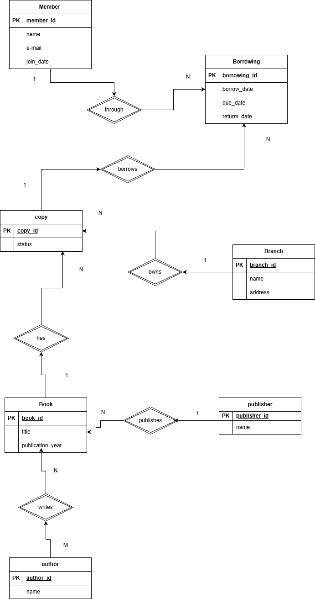

# Exercise 2: ER Modeling – Library Borrowing System

**Course:** Databases 26  
**Exercise:** 2  

**Student Name(s):**  
- Tasneem Roza
---

## Understanding the Problem

The goal of this assignment is to design an Entity-Relationship (ER) model for a small library system that tracks books, authors, publishers, members, physical copies, branches, and borrowing events.

---

## STEP 1 — Identify Candidate Entities (Noun Hunt)

Candidate entities identified from the scenario:

- Book  
- Publisher  
- Author  
- Member  
- Borrowing  
- Branch  
- Copy  

---

## STEP 2 — Final Entities + One-line Definition

| Entity | One-line definition |
|------|---------------------|
| Book | A published work identified by a title and publication year. |
| Publisher | A company or organization that publishes books. |
| Author | A person who writes one or more books. |
| Member | A person registered to borrow books from the library. |
| Branch | A physical library location. |
| Copy | A physical copy of a book owned by the library. |
| Borrowing | A record of a member borrowing a specific book copy. |

---

## STEP 3 — Choose Primary Keys (Identifiers)

| Entity | Primary Key (PK) |
|------|------------------|
| Book | book_id |
| Publisher | publisher_id |
| Author | author_id |
| Member | member_id |
| Branch | branch_id |
| Copy | copy_id |
| Borrowing | borrowing_id |

### Reflection: Why are names or titles usually not good primary keys?

Names or titles are not reliable primary keys because they are not guaranteed to be unique, they can change over time, and different entities may share the same name.

---

## STEP 4 — Essential Attributes

### Book
- **PK:** book_id  
- title  
- publication_year  

### Publisher
- **PK:** publisher_id  
- name  

### Author
- **PK:** author_id  
- name  

### Member
- **PK:** member_id  
- name  
- email  
- join_date  

### Branch
- **PK:** branch_id  
- name  
- address  

### Copy
- **PK:** copy_id  
- status  

### Borrowing
- **PK:** borrowing_id  
- borrow_date  
- due_date  
- return_date (optional)  

---

## STEP 5 — Identify Relationships (Verb Hunt)

- Publisher — publishes — Book  
- Author — writes — Book  
- Book — has — Copy  
- Branch — owns — Copy  
- Member — borrows — Copy (through Borrowing)  

---

## STEP 6 — Determine Cardinality

| Relationship | Cardinality | Reason |
|-------------|------------|--------|
| Publisher – Book | 1 : N | One publisher can publish many books, but each book has one publisher. |
| Author – Book | M : N | A book can have multiple authors and an author can write multiple books. |
| Book – Copy | 1 : N | The library can own multiple copies of the same book. |
| Branch – Copy | 1 : N | A branch can have many copies, but each copy belongs to one branch. |
| Member – Borrowing | 1 : N | A member can borrow many books over time. |
| Copy – Borrowing | 1 : N | The same copy can be borrowed multiple times over time. |

---

## STEP 7 — Optional vs Mandatory Participation

**Must every Book have a Publisher?**  
☑ Yes (Mandatory)  
**Why?** Each book has exactly one publisher according to the scenario.

**Can a Publisher exist with zero Books?**  
☑ Yes  
**Why?** A publisher may exist even if no books are currently registered.

**Must every Book have at least one Author?**  
☑ Yes  
**Why?** The scenario states that a book has one or more authors.

**Must every Copy belong to a Branch?**  
☑ Yes  
**Why?** Each physical copy belongs to exactly one branch.

**Is return_date in Borrowing mandatory or optional?**  
☑ Optional  
**Why?** A book may not have been returned yet.

---

## STEP 8 — ER Diagram

---

## STEP 9 — Add Relationships (Explanation)

- A publisher publishes many books, but each book has only one publisher.  
- An author can write many books, and a book can be written by many authors.  
- A book can have multiple physical copies.  
- Each copy belongs to exactly one branch.  
- Borrowing connects members and copies and stores borrowing-related dates.

---

## STEP 10 — Mark Cardinality & Optionality

All relationships in the ER diagram are marked with correct cardinality (1, N, M) and optional or mandatory participation based on the system requirements.

---

## SELF-CHECK (Validation Questions)

**Can a member borrow multiple books over time?**  
☑ Yes  
**Why?** A member can be associated with many borrowing records.

**Can the same copy be borrowed multiple times in different months?**  
☑ Yes  
**Why?** A copy can appear in many borrowing records over time.

**Can a book have multiple authors?**  
☑ Yes  
**Why?** The Author–Book relationship is many-to-many.

**Can a book exist without a publisher?**  
☑ No  
**Why?** Each book must have exactly one publisher.

**Can a borrowing have no return_date?**  
☑ Yes  
**Why?** The book may not yet have been returned.

---

## Problems, Issues & Comments

No major problems were encountered while completing this assignment.